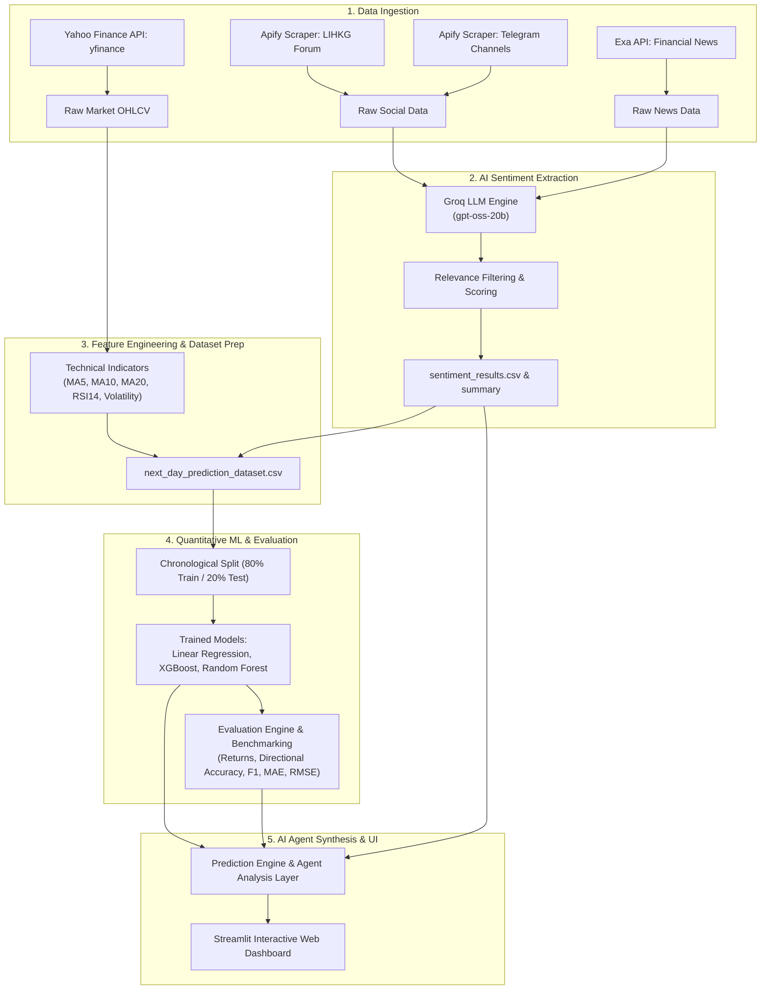

# HengSeng Stock Sentiment & Price Prediction Agent

An end-to-end, multi-source financial machine learning and AI agent platform designed to analyze, predict, and synthesize market sentiment for five bellwether stocks listed on the Hong Kong Stock Exchange (Hang Seng Index):

| Company | Ticker | Sector |
|---|---|---|
| **HSBC Holdings** | `0005.HK` | Banking & Financials |
| **Tencent Holdings** | `0700.HK` | Technology & Interactive Media |
| **Alibaba Group** | `9988.HK` | E-Commerce & Cloud Infrastructure |
| **Meituan** | `3690.HK` | Consumer Internet & On-Demand Delivery |
| **Xiaomi Corporation** | `1810.HK` | Consumer Electronics & Smart Hardware |

---

## 1. Problem Statement

Financial market movements are driven by an intricate combination of historical price action, order flow momentum, macroeconomic events, institutional news releases, and retail social sentiment. However, retail and quantitative analysts face major challenges:
1. **Unstructured Multilingual Sentiment**: Hong Kong equities have high retail participation in Cantonese/Traditional Chinese forums (such as LIHKG) and global channels (Telegram and English financial news).
2. **Naive Price Prediction Traps**: Standard regression models trained on nominal prices frequently fall into the trap of predicting $\hat{y}_{t+1} \approx y_t$ (the "Random Walk" or martingale persistence). Without empirical benchmark comparisons, naive baseline superiority is hidden.
3. **Lack of Agentic Synthesis**: Isolated machine learning predictions do not provide actionable context without technical support/resistance levels, RSI momentum checks, and multi-source signal divergence detection.

This project addresses these challenges by integrating **multi-source social & news scrapers**, **LLM-based financial sentiment extraction**, **machine learning price and return forecasting**, and an **AI Agent analytical layer** in a production-ready **Streamlit interactive dashboard**.

---

## 2. Key Features

- **Multi-Source Data Harvesting**:
  - **Social Media Scrapers (Apify)**: Scrapes discussions and threads from **LIHKG** (Hong Kong's primary retail trading community) and **Telegram** financial channels.
  - **Financial News (Exa API)**: Neural search collecting the latest corporate press releases, earnings updates, and institutional financial journalism.
  - **Market Historical Data (yfinance)**: Two years of daily OHLCV trading bars with timezone alignment to Hong Kong trading hours (`Asia/Hong_Kong`).
- **AI Sentiment Analysis Pipeline (Groq LLM)**:
  - High-throughput LLM sentiment reasoning (`openai/gpt-oss-20b` via Groq) returning structured JSON with confidence, directional impact, and financial reasoning.
  - Excludes irrelevant promotional posts and unclassified noise from sentiment aggregation.
- **Quantitative Machine Learning & Benchmark Architecture**:
  - Chronological 80/20 train/test split to prevent look-ahead bias and data leakage.
  - Evaluates **Linear Regression**, **XGBoost**, and **Random Forest** against the **Previous-Close Baseline** across price MAE, price RMSE, daily return MAE, directional accuracy, precision, recall, and F1-score.
  - Strict empirical honesty: transparently illustrates the Random Walk hypothesis in financial markets.
- **AI Agent Synthesis Layer**:
  - Automatically compares technical moving averages with social and news sentiment.
  - Detects signal divergence (e.g., retail bullishness during institutional downgrades or bearish technical trends) and outputs cautious, non-fabricated investment summaries.
- **Interactive Multi-View Streamlit Dashboard**:
  - Market Overview with key KPI metrics.
  - Individual stock analysis cards with explainable support/resistance, RSI, and agent commentary.
  - Interactive Plotly visualizations for sentiment distribution, source comparisons, and return trajectories.
  - Dedicated Empirical Model Evaluation & Benchmarking tab.

---

## 3. System Architecture



---

## 4. Technologies Used

- **Language & Runtime**: Python 3.12+ (or 3.14 via UV)
- **Package Management**: UV (`uv`)
- **Data Scraping & APIs**:
  - `apify-client`: Apify actor integration for LIHKG & Telegram
  - `exa-py`: Exa neural search API for financial news
  - `yfinance`: Yahoo Finance market data
- **AI & Sentiment Inference**:
  - `groq`: Fast LLM inference with Groq Cloud API
  - `python-dotenv`: Environment variable management
- **Machine Learning & Analytics**:
  - `scikit-learn`: Linear Regression, Random Forest, metrics calculation
  - `xgboost`: Gradient boosted tree regression
  - `pandas`, `numpy`: Time series and vector processing
- **Visualization & UI**:
  - `streamlit`: Web dashboard
  - `plotly`: Interactive financial charts and metrics

---

## 5. Project Folder Structure

```
.
├── .env.example                       # Example environment variable template
├── .gitignore                          # Git ignore configuration (secrets, caches, venv)
├── pyproject.toml                      # Project metadata and dependencies
├── README.md                           # Comprehensive documentation
├── uv.lock                             # Locked dependency tree
├── data/
│   └── processed/
│       ├── next_day_prediction_dataset.csv   # Combined features with target
│       ├── sentiment_results.csv             # Individual classified items with reasons
│       └── sentiment_summary.csv             # Stock-level aggregated sentiment
├── models/
│   ├── linear_regression.joblib        # Serialized Linear Regression model
│   ├── random_forest.joblib            # Serialized Random Forest model
│   └── xgboost.joblib                  # Serialized XGBoost model
├── reports/
│   ├── eda/                            # Exploratory data analysis reports & charts
│   ├── model_evaluation/
│   │   ├── model_evaluation_report.md  # Detailed markdown evaluation report
│   │   ├── overall_comprehensive_evaluation.csv # All models evaluation table
│   │   ├── per_ticker_return_evaluation.csv     # Per-stock evaluation breakdown
│   │   ├── test_predictions.csv        # Out-of-sample predictions on test window
│   │   ├── actual_vs_predicted_prices.html
│   │   └── actual_vs_predicted_returns.html
│   └── predictions/
│       └── latest_stock_predictions.csv # Current agent predictions & synthesis
└── src/
    ├── config.py                       # Configuration & API checks
    ├── main.py                         # End-to-end execution pipeline
    ├── agents/
    │   └── sentiment_agent.py          # AI agent synthesis & divergence engine
    ├── collectors/
    │   ├── market_collector.py         # Historical market data collector
    │   ├── news_collector.py           # Exa news collector
    │   ├── social_collector.py         # Apify social scraper (LIHKG + Telegram)
    │   └── data/raw/                   # Raw harvested market, news, social CSVs
    ├── dashboard/
    │   └── app.py                      # Multi-tab Streamlit dashboard
    ├── modelling/
    │   ├── eda.py                      # EDA & feature correlation generator
    │   ├── evaluate_metrics.py         # Comprehensive return & directional evaluator
    │   ├── prediction_engine.py        # Prediction & agent synthesis runner
    │   └── train_models.py             # Chronological ML training script
    ├── prediction/
    │   ├── train.py                    # Wrapper entry point for training
    │   └── evaluate.py                 # Wrapper entry point for evaluation
    ├── sentiment/
    │   ├── analyzer.py                 # Groq LLM sentiment classifier
    │   └── prepare_dataset.py          # Dataset builder joining market & sentiment
    └── visualization/
        └── dashboard.py                # Wrapper entry point for dashboard
```

---

## 6. Installation & Setup Instructions

### Prerequisites
- Python 3.12+ (or UV installed)
- [uv](https://docs.astral.sh/uv/) installed (recommended) or standard `pip`

### Step 1: Clone Repository & Create Virtual Environment
Using `uv`:
```bash
uv sync
```
Or using standard Python virtual environment:
```bash
python -m venv .venv
# On Windows:
.venv\Scripts\activate
# On Linux/macOS:
source .venv/bin/activate

pip install -r pyproject.toml
```

### Step 2: Configure Environment Variables
Copy `.env.example` to `.env`:
```bash
cp .env.example .env
```
Fill in your API credentials:
```ini
APIFY_TOKEN=your_apify_token_here
EXA_API_KEY=your_exa_api_key_here
GROQ_API_KEY=your_groq_api_key_here
OPENAI_API_KEY=your_optional_openai_key_here
```
Verify your configuration:
```bash
uv run python src/config.py
```

---

## 7. How to Run Each Pipeline Stage

### 1. Data Collection
*(Pre-collected raw datasets are already provided in `src/collectors/data/raw/` so API calls are not required unless refreshing data.)*
- Collect Market Data:
  ```bash
  uv run python src/collectors/market_collector.py
  ```
- Collect Financial News (requires Exa key):
  ```bash
  uv run python src/collectors/news_collector.py
  ```
- Collect Social Discussions (requires Apify key):
  ```bash
  uv run python src/collectors/social_collector.py
  ```

### 2. Sentiment Analysis
*(Classified sentiment results are included in `data/processed/sentiment_results.csv`.)*
- Run sentiment classification via Groq:
  ```bash
  uv run python src/sentiment/analyzer.py
  ```

### 3. Dataset Preparation
- Merge technical indicators and sentiment into the machine learning dataset:
  ```bash
  uv run python src/sentiment/prepare_dataset.py
  ```

### 4. Train Models
- Train Linear Regression, XGBoost, and Random Forest using chronological splits:
  ```bash
  uv run python src/modelling/train_models.py
  ```

### 5. Evaluate Models & Benchmarks
- Generate comprehensive return metrics, directional accuracy, F1-scores, and HTML comparison charts:
  ```bash
  uv run python src/modelling/evaluate_metrics.py
  ```

### 6. Run Prediction Engine & AI Agent
- Generate multi-factor predictions, technical support/resistance, and agent interpretation:
  ```bash
  uv run python src/modelling/prediction_engine.py
  ```

### 7. Run Complete End-to-End Pipeline
- Execute evaluation and prediction pipeline in a single command:
  ```bash
  uv run python src/main.py
  ```

### 8. Launch Streamlit Web Dashboard
```bash
uv run streamlit run src/dashboard/app.py
```
Open your browser at `http://localhost:8501`.

---

## 8. Empirical Model Evaluation Results

### Overall Out-of-Sample Performance (Test Window: 495 daily samples)

| Model | Price MAE (HKD) | Price RMSE | Return MAE | Return RMSE | Directional Accuracy | Precision | Recall | F1-Score |
|---|---|---|---|---|---|---|---|---|
| **Previous Close Baseline** | **2.7623** | **4.8777** | **0.0190** | **0.0260** | 54.95%* | 0.0000 | 0.0000 | 0.0000 |
| **Linear Regression** | 2.8622 | 4.9656 | 0.0206 | 0.0281 | 46.26% | 0.4266 | **0.5605** | **0.4845** |
| **XGBoost** | 3.1730 | 5.4524 | 0.0231 | 0.0310 | 51.31% | **0.4605** | 0.4709 | 0.4656 |
| **Random Forest** | 3.5355 | 6.1923 | 0.0242 | 0.0328 | 49.70% | 0.4375 | 0.4081 | 0.4223 |

*\*Note on Baseline Directional Accuracy: The baseline assumes zero change every day ($\hat{r}_{t+1}=0$). In binary Up/Down classification (where Up is strictly positive return $r > 0$ and Down is $r \le 0$), the naive baseline default predicts "not up" for all instances. Because the test period had a slight downward bias (54.95% flat or down trading days), predicting zero change mechanically captures the majority class but produces 0.0000 Precision and Recall. Conversely, XGBoost produces a balanced 51.31% accuracy with 0.4656 F1.*

### Per-Stock Performance Summary (Return MAE & Directional Accuracy)

| Ticker | Company | Best Model by Return MAE | Baseline Return MAE | Linear Regression Return MAE | XGBoost Return MAE | Directional Accuracy (XGBoost) |
|---|---|---|---|---|---|---|
| `0005.HK` | HSBC | Baseline | 0.0119 | 0.0123 | 0.0128 | **56.57%** |
| `0700.HK` | Tencent | Baseline | 0.0172 | 0.0175 | 0.0203 | **55.56%** |
| `1810.HK` | Xiaomi | Baseline | 0.0249 | 0.0298 | 0.0370 | 44.44% |
| `3690.HK` | Meituan | Baseline | 0.0193 | 0.0208 | 0.0221 | **52.53%** |
| `9988.HK` | Alibaba | Baseline | 0.0218 | 0.0227 | 0.0234 | 47.47% |

---

## 9. Limitations & Practical Constraints

1. **Random Walk Dynamics**: Daily price changes of major large-cap equities are largely martingale-like in the short term. Machine learning models estimating nominal price levels inevitably track the previous day's close with slight variance.
2. **Sentiment Backtest Coverage**: High-quality social discussions (LIHKG/Telegram) and news articles were sampled over the latest 10-day monitoring window. Because historical social and news APIs are paid and quota-constrained, long-term historical backtests relied on technical price and volume features.
3. **Execution & Slippage**: Predictions do not incorporate transaction fees, Hong Kong stamp duty (0.1%), exchange trading fees, or market bid-ask slippage.

---

## 10. Future Improvements

1. **Multi-Horizon Forecasting**: Extend the model from next-day predictions to 5-day, 10-day, and 20-day cumulative return horizons where sentiment trends have higher statistical predictive power.
2. **Direct Return Classification**: Formulate the learning objective directly as a classification problem (e.g., predicting significant price moves > 1% vs sideways drift) rather than nominal price regression.
3. **Automated Continuous Ingestion**: Deploy asynchronous scheduled workers to ingest daily LIHKG threads and market news automatically into a time-series database.
4. **Order Flow & Sector Regimes**: Incorporate Southbound Stock Connect flow (Mainland capital inflow) and Hang Seng Tech Index beta into the feature pipeline.

---

## 11. Disclaimer

*This project is built strictly for academic, research, and technical evaluation purposes. The forecasts and AI agent outputs generated by this system do not constitute investment advice, financial recommendations, or trading signals. Always conduct independent research before making financial decisions.*
